# wistlet

A small social network written in ASP.NET Core (.NET 10, Razor Pages, EF Core + SQLite),
styled after cohost as it looked in 2022: the cherry header bar, off-white page, Atkinson
Hyperlegible, post boxes with tinted header and footer strips, big avatars beside the feed,
profile header images with the cherry project box, longan titled boxes and tag pills.

The cohost styles come from the stylesheet preserved by
[cohost-dl](https://github.com/cpsdqs/cohost-dl) (MIT), vendored in
`src/Wistlet/wwwroot/lib/cohost/`. Wistlet's own additions (navigation, forms, menus,
composer, admin pages) are in `wwwroot/css/site.css` and use the same colour tokens.

## Screenshots

| | |
|---|---|
| 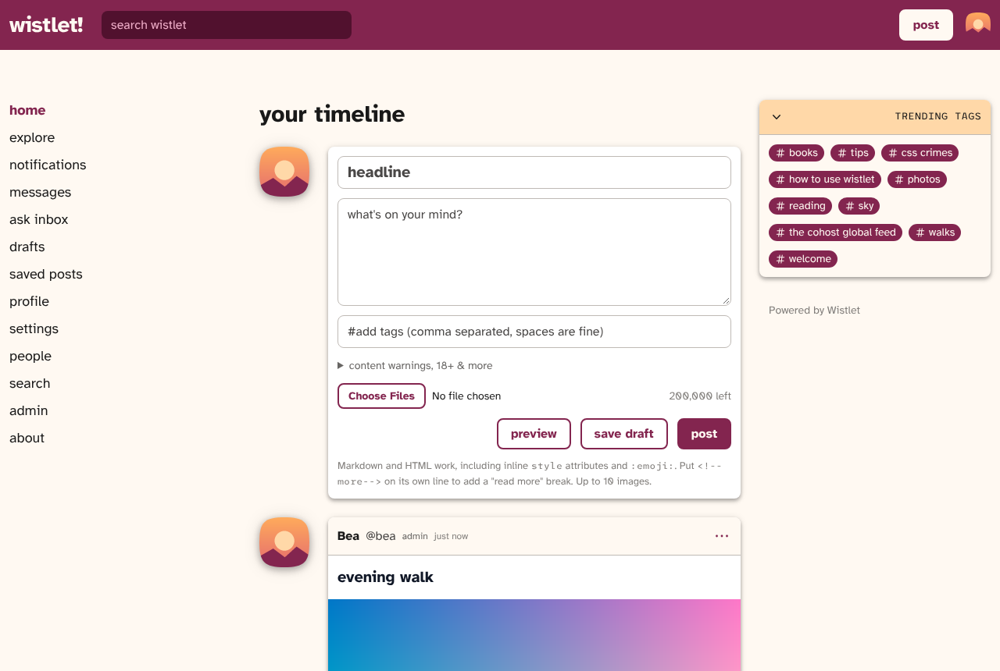 | 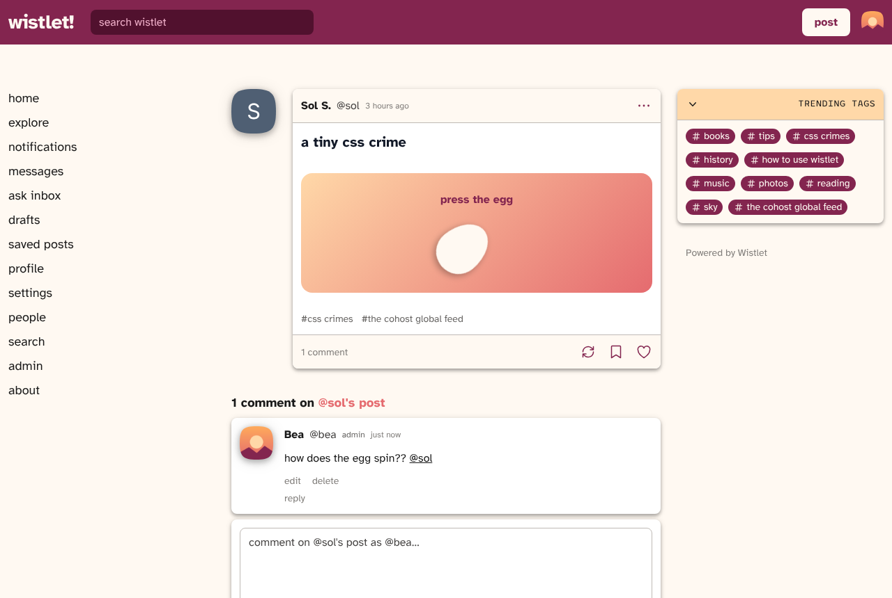 |
| **Home timeline** | **A CSS crime and its comments** |
| 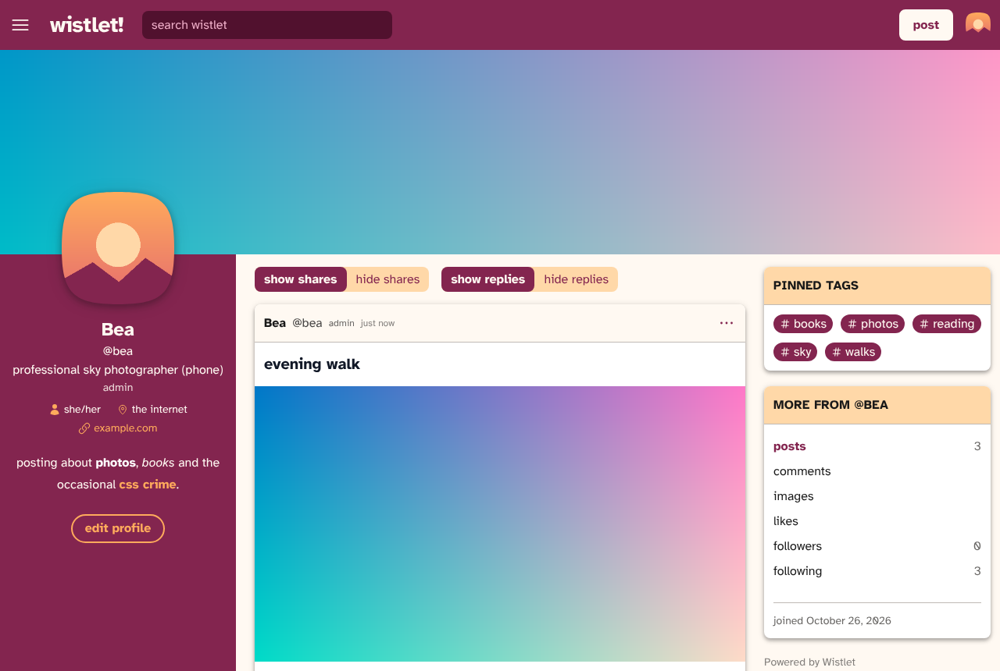 | 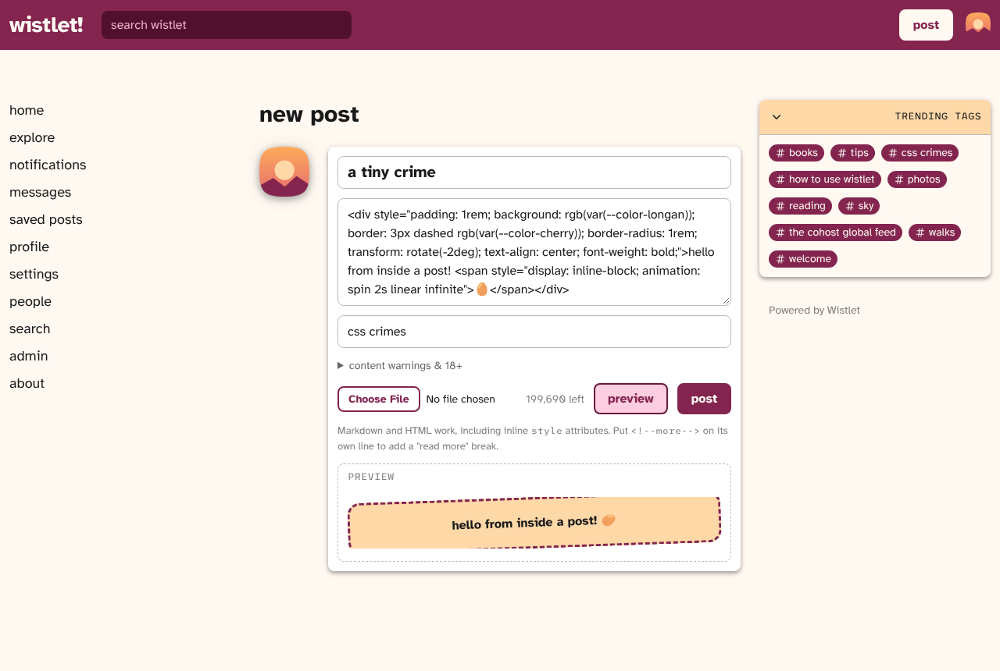 |
| **Profile with a header image** | **Composer preview** |
| 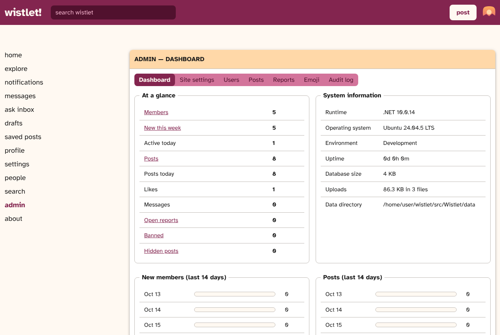 | 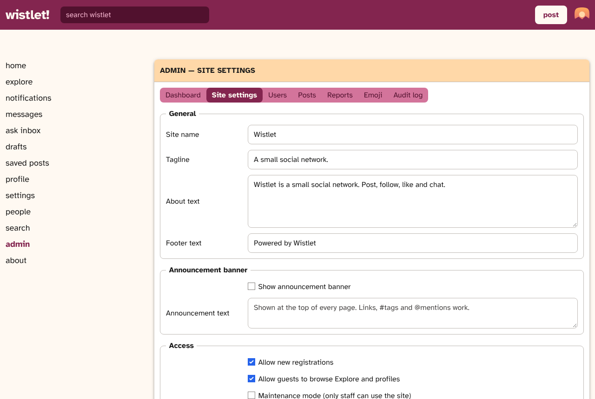 |
| **Admin dashboard** | **Site settings** |
| 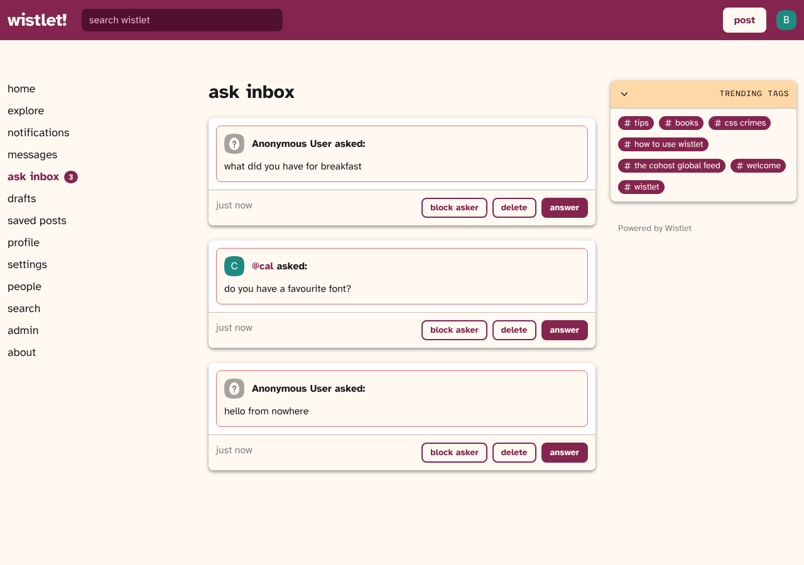 | 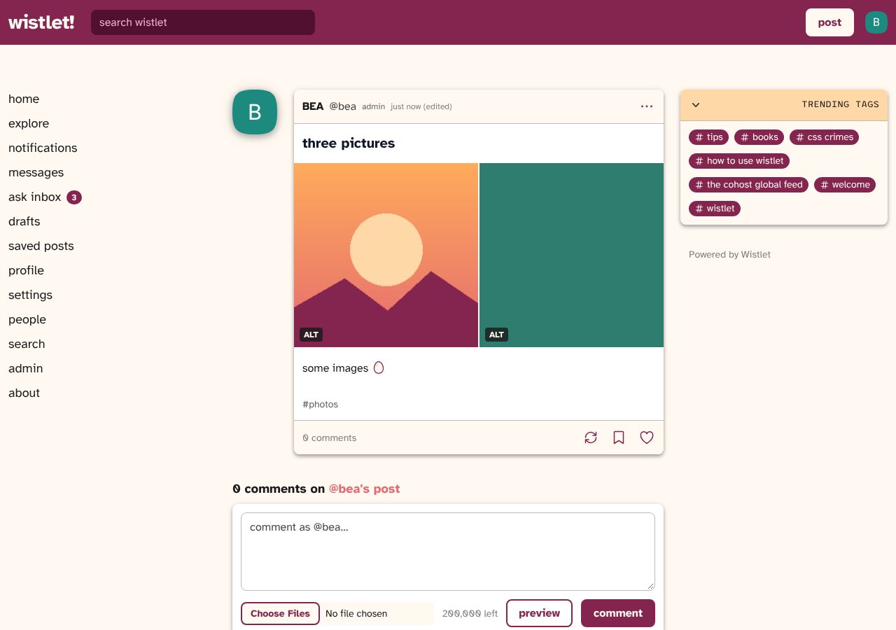 |
| **Ask inbox** | **Images with alt text** |
| 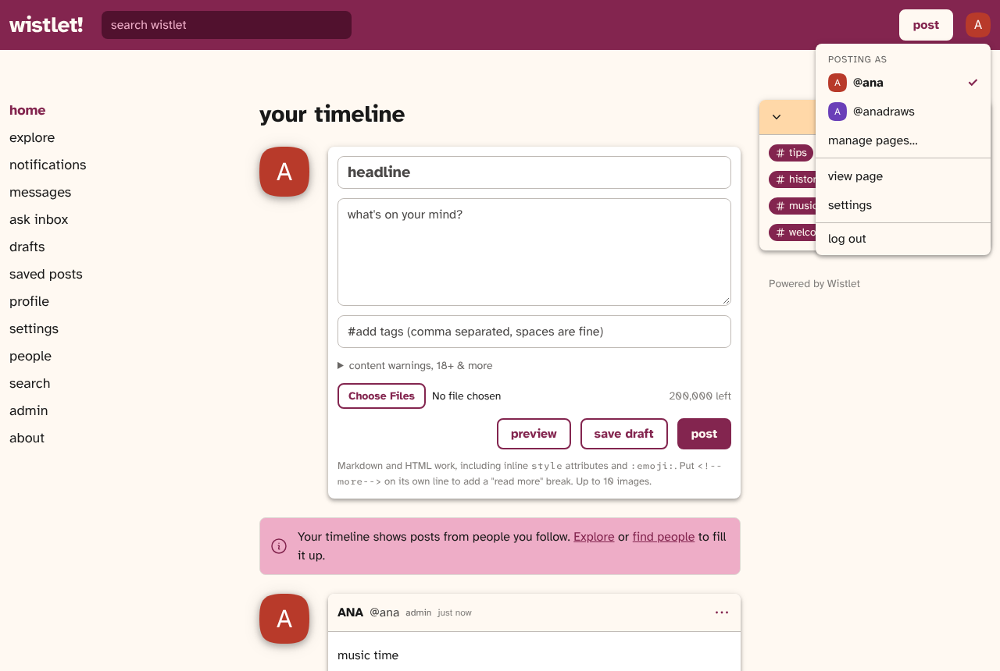 | |
| **Switching pages** | |
| 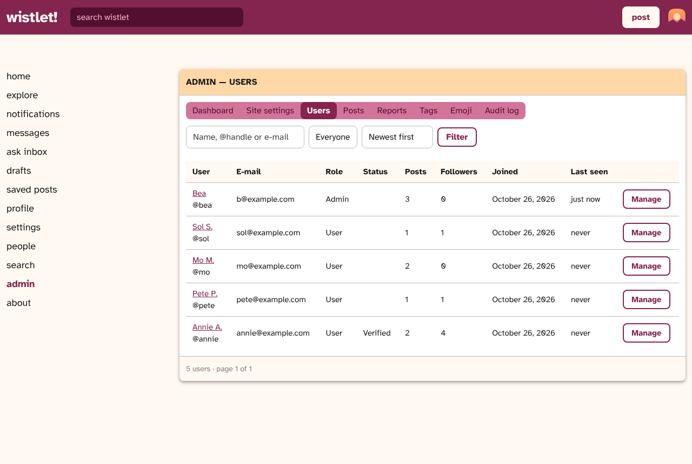 | 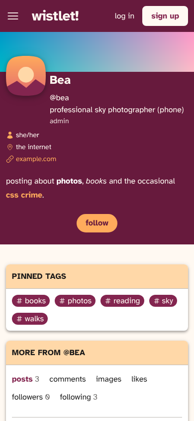 |
| **User management** | **On a phone** |

## Features

**Posts, the cohost way**
- Markdown with raw HTML and inline CSS ("CSS crimes"), up to 200 000 characters, an optional
  headline, and up to 10 images, each with alt text (shown with an ALT badge and in the lightbox)
- Custom emoji (`:egg:`) managed by admins, usable in posts, comments and profile descriptions
- A preview button in the composer that renders the draft through the same sanitizer posts use
- A `<!--more-->` line splits off the part shown in feeds ("read more"); very tall posts (over
  twice the window height) are collapsed automatically
- Tags in a separate field, shown in order below the post (`#tag` pages and trending tags)
- Content warnings and an 18+ flag: such posts start collapsed, and other people's 18+ posts only
  appear for viewers who opted in under Settings → Privacy
- Shares (with or without your own post on top), share chains, and a "deleted by its original
  author" tombstone when the shared post is gone
- Comments as nested threads on the post page (not in feeds), editing your own posts and comments
- Drafts: save a post for later, share its link with people before publishing, publish it from the
  drafts page
- Lock comments (only you can comment) or shares (nobody can share) per post
- Pin posts to the top of your page
- `@mentions`, likes and saved posts

**Asks**
- An ask box on every page, signed or anonymous; pages choose whether they take asks at all,
  anonymous asks, and asks from people who aren't logged in
- An ask inbox: answer an ask (it's posted with the ask embedded on top), delete it, or block the
  asker (works for anonymous asks without revealing who sent them)
- The asker is notified when their ask is answered; profiles can show or hide asks

**Tags**
- Follow tags: their posts join your home timeline, and they're listed in the sidebar
- Silence tags (their posts disappear from your feeds) or CW them (their posts start collapsed)

**Pages**
- One login can run several pages (up to 10), each with its own handle, profile, posts, followers,
  asks, messages, notifications and settings, like cohost's projects
- Switch pages from the menu under your avatar or from `/pages`, where you also add and delete pages;
  everything you do happens as the page you're posting as
- Extra pages have no password of their own; e-mail, password and sessions belong to the account.
  Nobody else can see which pages share an account (admins can)

**Link embeds**
- A link on its own line becomes an embed below the post, as on cohost
- YouTube links get a player that loads nothing from YouTube until you press play, and then uses the
  privacy-enhanced youtube-nocookie.com player
- Other links get a preview card (title, description, image, site) read from the page's OpenGraph
  tags. The server fetches these in the background, only from public addresses on ports 80 and 443
  (every connection is checked, so redirects and DNS tricks can't reach your network), with size and
  time limits. Admins can turn previews off

**Social**
- Follow / unfollow, home timeline, explore (latest, top this week, media), people directory
- Private pages: only followers you approve see your posts, follows become requests you approve or
  decline, and private posts can't be shared
- Profiles with picture (squircle, circle, rounded square, egg or capsule shape), header image (banner),
  tagline, pronouns, a Markdown description, location and website, laid out like a 2022 cohost page:
  the project box down the left, show/hide filters for shares and replies, pinned (most used) tags
  with per-profile tag pages, and links to the account's comments, images, likes, followers and following
- A contact card on the profile, with lines that only followers can see
- An Atom feed for every public page at `/u/<name>/feed.atom`
- Notifications for likes, comments, shares, mentions, answered asks, new followers, follow requests
  and moderator messages
- Direct messages, with a per-user privacy setting (everyone / people I follow / nobody)
- Blocking, reporting posts and accounts, search across people, tags and posts

**Admin panel** (`/admin`, for moderators and admins)
- Dashboard: counts, sign-ups and posts per day, newest members, system information
- Site settings (admins only): site name, tagline, about text, footer, announcement banner,
  open/closed registration, guest browsing, maintenance mode, maximum post length, posts per page,
  image uploads and size limit, banned words, direct messages on/off
- User management: search and filter, edit name/e-mail/role/verified badge, temporary or permanent
  bans with a reason, password reset, sign out all sessions, remove picture, clear profile,
  remove banner, moderator messages, delete all posts, delete account
- Post management: search and filter (reported, hidden, pinned, images), hide, pin to Explore, delete
- Custom emoji (admins only): upload an image under a shortcode; posts that use it update right away
- Accounts and their extra pages: the user list shows which account a page belongs to; password
  resets and sign-outs apply to the account, and banning an account hides all of its pages
- Reports queue: dismiss, resolve, hide or delete the post, jump to the author
- Audit log (admins only) of every moderation action

**Roles:** `User`, `Moderator` (users, posts, reports) and `Admin` (everything). The first account
registered on a fresh install becomes the admin, or one can be created from environment variables
(see below). The last remaining admin can't be demoted or deleted.

**Security:** PBKDF2 password hashing, antiforgery tokens on every form, cookies re-validated on each
request (bans, password changes and role changes take effect immediately), rate limiting on log-in,
sign-up and posting, uploads checked by file signature and stored under random names, a strict
Content-Security-Policy and other security headers.

## CSS crimes

Posts keep what cohost allowed and drop what it removed. The rules follow
[prechoster](https://github.com/cpsdqs/prechoster)'s documentation of cohost's renderer, and are
implemented in `Services/PostRenderer.cs` (Markdig for Markdown, AngleSharp for the HTML pass):

- Kept: `div`, `span`, `details`/`summary`, tables, images, audio and video, headings, lists,
  `ruby`, `mark`, `kbd` and the other text-level elements, with their `style` attributes.
- Removed with their content: `script`, `style`, `iframe`, `svg`, `canvas`, `form` fields and the
  like. Unknown elements are unwrapped so their text stays.
- `class` and event handler attributes are dropped. `id`s get a `user-content-` prefix and `#links`
  are rewritten to match. `<input>` becomes a disabled checkbox.
- In `style`: no custom properties (`--x`), no `!important`, `position: fixed` becomes `static`, and
  `url()` only takes http(s), relative or `data:image/`/`data:font/` URLs. The site's colour tokens
  (`rgb(var(--color-cherry))` …) and the `spin` and `bounce` keyframes are available.
- Links get `rel="nofollow noopener noreferrer ugc"`; only http(s), mailto and relative links survive.
- The post body is a contained box (`isolation`, `contain: paint`), so nothing escapes onto the page.

`:shortcode:` in text (outside code) becomes the site's emoji image.

Posts are rendered once when saved. When the rules change, `PostRenderer.Version` is bumped and
older posts are re-rendered on start-up.

## Deploying with Docker Compose and Caddy

Docker runs only the app. Caddy runs **on the host** (installed from your distribution's packages or
the official binary), so Docker never pulls a Caddy image. The app is published on `127.0.0.1:8080`,
which means it can only be reached through Caddy.

1. Install Caddy on the server: <https://caddyserver.com/docs/install>.
2. Configure and start the app:
   ```sh
   cp .env.example .env        # optional: set an admin account, port, …
   docker compose up -d --build
   ```
3. Point Caddy at it: edit the domain in `Caddyfile`, then
   ```sh
   sudo cp Caddyfile /etc/caddy/Caddyfile
   sudo systemctl reload caddy
   ```
   Caddy obtains and renews the HTTPS certificate automatically.

All data (SQLite database, uploads, cookie encryption keys) lives in the `wistlet-data` volume,
mounted at `/data`. To back it up:

```sh
docker run --rm -v wistlet_wistlet-data:/data -v "$PWD":/backup busybox tar czf /backup/wistlet-backup.tgz -C /data .
```

### Configuration

| Variable (`.env`)        | Meaning                                                        | Default |
|--------------------------|----------------------------------------------------------------|---------|
| `WISTLET_PORT`           | Host port on 127.0.0.1 that Caddy proxies to                   | `8080`  |
| `WISTLET_ADMIN_USER`     | Create (or promote) this admin account on start-up            | —       |
| `WISTLET_ADMIN_PASSWORD` | Password for that account (only used when it's created)        | —       |
| `WISTLET_ADMIN_EMAIL`    | E-mail for that account                                        | —       |
| `WISTLET_SEED_DEMO`      | Add a few demo users and posts to an empty site                | `false` |

Everything else is changed from the admin panel at runtime.

If you change the port, change it in the `Caddyfile` as well.

## Development

Requires the .NET 10 SDK.

```sh
cd src/Wistlet
dotnet run
```

In development the app stores its data in `src/Wistlet/data/` and seeds a few demo users and posts.
Register an account and it becomes the admin.

Database schema changes go through EF Core migrations:

```sh
dotnet tool restore
dotnet ef migrations add <Name> --project src/Wistlet -o Data/Migrations
```

Migrations are applied automatically when the app starts.

To try link previews against a site on your own machine, set
`Wistlet__LinkPreviewsAllowPrivateAddresses=true`; it lifts the public-address and port checks, so
never set it on a real server.

The sanitizer, embed detection and address checks have unit tests:

```sh
dotnet test
```

## Project layout

```
src/Wistlet/
  Data/            EF Core context, migrations, start-up initialisation
  Models/          Entities and view models
  Services/        Accounts, posts and the post renderer, notifications, messaging, uploads, site settings, audit log
  Infrastructure/  Auth cookie validation, middleware, tag helpers, formatting helpers
  Pages/           Razor Pages (Admin/, Account/, Messages/ and the social pages)
  wwwroot/         site.css, site.js, vendored cohost styles, Atkinson Hyperlegible and League Mono
tests/Wistlet.Tests/  Unit tests for the post renderer
Dockerfile, docker-compose.yml, Caddyfile
```

## Licences

These are vendored under `src/Wistlet/wwwroot/lib/` together with their licence files:

- `cohost/`: the cohost stylesheet and prose styles from cohost-dl (MIT). Wistlet's copy
  points the fonts at the self-hosted files, removes the dark-mode rules (cohost was light-only
  in 2022) and uses its own egg and capsule mask shapes.
- `atkinson-hyperlegible/` and `league-mono/`: fonts under the SIL Open Font Licence.

The starter emoji and the anonymous asker avatar in `wwwroot/img/` were drawn for Wistlet.
